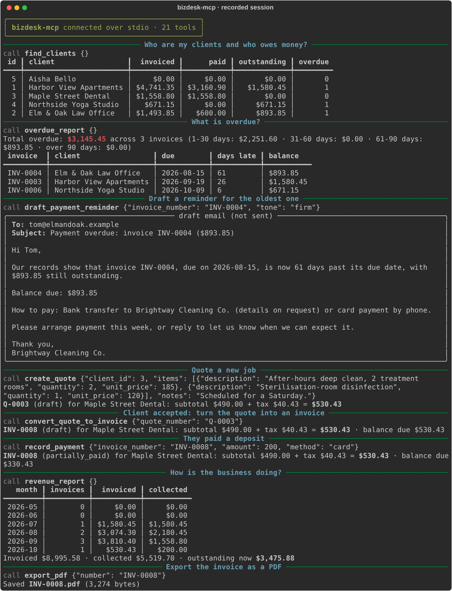
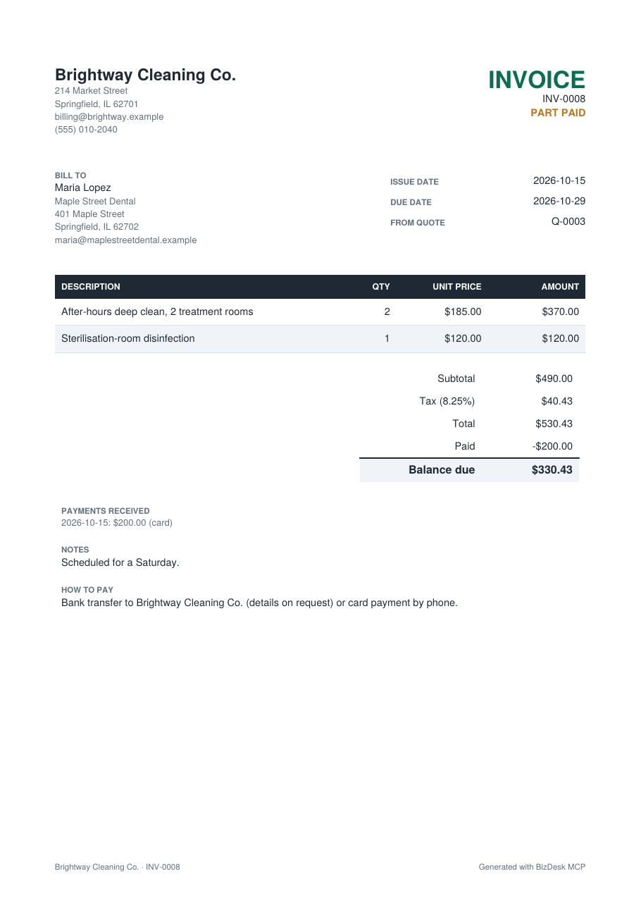
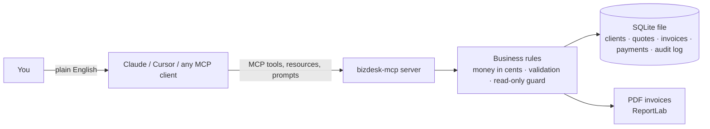

# BizDesk MCP

**Give Claude a small-business back office.** BizDesk is an [MCP](https://modelcontextprotocol.io) server that lets Claude (or any MCP client, such as Cursor) manage clients, quotes, invoices, payments and reports, and export invoices as PDFs. Your data stays in one SQLite file on your own computer.

[](https://github.com/bikashnayak36331-pixel/bizdesk-mcp/actions/workflows/ci.yml)


> "Who still owes me money?" · "Quote Maple Street Dental for two after-hours deep cleans at $185 each." · "They accepted. Invoice it and log a $200 card deposit." · "Write a firm reminder for the oldest overdue invoice." · "How did September compare with August?"



<sub>Real output from `scripts/demo_session.py`, which drives the actual server over stdio with the fictional demo data. The full request and response log is in [docs/demo-session.md](docs/demo-session.md).</sub>

## What it does

| Area | Tools |
|---|---|
| Business profile | `get_business_profile`, `update_business_profile` (name, address, currency, tax rate, payment terms, how to pay) |
| Clients | `add_client`, `find_clients`, `get_client`, `update_client`, with invoiced / paid / outstanding totals per client |
| Quotes | `create_quote`, `list_quotes`, `set_quote_status`, `convert_quote_to_invoice` |
| Invoices | `create_invoice`, `get_document`, `list_invoices` (filter by status, client, overdue), `mark_invoice_sent`, `void_invoice` |
| Payments | `record_payment` (part payments, with overpayments refused) |
| Reports | `overdue_report` (aged 1-30 / 31-60 / 61-90 / 90+ days), `revenue_report` (invoiced vs collected by month, top clients) |
| Follow-up | `draft_payment_reminder`: friendly, firm or final email text. **It never sends anything.** |
| Documents | `export_pdf`: a clean PDF of any quote or invoice |
| Audit | `recent_activity`: every change, with a timestamp |

There are also **resources** (`bizdesk://profile`, `bizdesk://reports/overdue`, `bizdesk://documents/{number}` as Markdown) and **prompts** (`month_end_review`, `quote_new_job`) that walk Claude through common jobs.

<p align="center"></p>

## Quick start

You need [uv](https://docs.astral.sh/uv/) (it installs Python for you).

**1. Try it with demo data** (optional; a fictional cleaning company with 5 clients and 7 invoices):

```bash
uvx --from git+https://github.com/bikashnayak36331-pixel/bizdesk-mcp bizdesk-mcp --db ~/BizDesk/demo.db --seed-demo
```

**2. Connect it to your MCP client.**

<details open><summary><b>Claude Desktop</b></summary>

Settings → Developer → Edit Config, then add the server (also in [examples/claude_desktop_config.json](examples/claude_desktop_config.json)):

```json
{
  "mcpServers": {
    "bizdesk": {
      "command": "uvx",
      "args": ["--from", "git+https://github.com/bikashnayak36331-pixel/bizdesk-mcp", "bizdesk-mcp"],
      "env": { "BIZDESK_DB": "~/BizDesk/bizdesk.db", "BIZDESK_OUTPUT_DIR": "~/BizDesk/pdfs" }
    }
  }
}
```

Restart Claude Desktop. To try the demo data, point `BIZDESK_DB` at `~/BizDesk/demo.db`.
</details>

<details><summary><b>Claude Code</b></summary>

```bash
claude mcp add bizdesk -e BIZDESK_DB=$HOME/BizDesk/bizdesk.db -- \
  uvx --from git+https://github.com/bikashnayak36331-pixel/bizdesk-mcp bizdesk-mcp
claude mcp list   # should show: bizdesk ... ✓ Connected
```
</details>

<details><summary><b>Cursor and other clients</b></summary>

Use the same `command` and `args` as above (see [examples/cursor_mcp.json](examples/cursor_mcp.json)).

To run it as a web service instead of a local process (Streamable HTTP):

```bash
bizdesk-mcp --transport streamable-http --host 127.0.0.1 --port 8000   # endpoint: http://127.0.0.1:8000/mcp
```

This mode has no login of its own, so keep it on localhost or put it behind your own authentication.
</details>

## Settings

| Flag | Environment variable | Default | Meaning |
|---|---|---|---|
| `--db PATH` | `BIZDESK_DB` | `~/.bizdesk/bizdesk.db` | The SQLite file holding all data |
| `--output-dir DIR` | `BIZDESK_OUTPUT_DIR` | `~/.bizdesk/pdfs` | Where `export_pdf` saves files |
| `--read-only` | `BIZDESK_READ_ONLY=1` | off | Allow looking but not changing (good for an accountant or a shared view) |
| `--transport` | | `stdio` | `stdio` or `streamable-http` |
| `--seed-demo` | | | Load the fictional demo data into an empty database, then exit |

## How it works



- `server.py`: MCP layer (tools, resources, prompts), built on the official MCP Python SDK v2 (`MCPServer`).
- `service.py`: business rules. Every change runs in a database transaction, so a failure leaves nothing half-written.
- `money.py`: exact maths. Amounts are stored as integer cents and quantities as thousandths, with half-up rounding done once per line.
- `store.py`: SQLite schema and the audit log. `pdf.py`: invoice and quote PDFs.

## Design choices

- **Your data stays local.** Nothing leaves your machine. BizDesk makes no network calls and never sends email; reminders are drafts for you to send.
- **Mistakes come back as clear tool errors** that Claude can fix and retry, for example "Payment of $5,000.00 is more than the balance due ($893.85) on INV-0004".
- **Tool hints**: read-only tools are marked `readOnlyHint` and `void_invoice` is marked `destructiveHint`, so clients can ask before risky actions.
- **Invoice numbers** (`INV-0001`, `Q-0001`) are never reused or skipped, even if a write fails.
- **Draft invoices** don't count as revenue or as overdue until you mark them sent.

## Development

```bash
git clone https://github.com/bikashnayak36331-pixel/bizdesk-mcp && cd bizdesk-mcp
uv venv && uv pip install -e ".[dev]"
pytest                          # 49 tests: unit, PDF content, in-process MCP client, stdio and HTTP transports
ruff check . && ruff format --check .
python scripts/demo_session.py  # re-record docs/demo-session.* and the PDF images
```

## Need a custom version?

The same pattern connects Claude to your own systems: a CRM, a booking database, a Google Sheet, Shopify, Stripe or QuickBooks, or an internal API, with the tools and guard-rails your team needs. Open an issue or contact me through my GitHub profile.

## Credits

Built by Bikash Nayak, using Claude (Anthropic) as a coding assistant. Released under the [MIT License](LICENSE).
